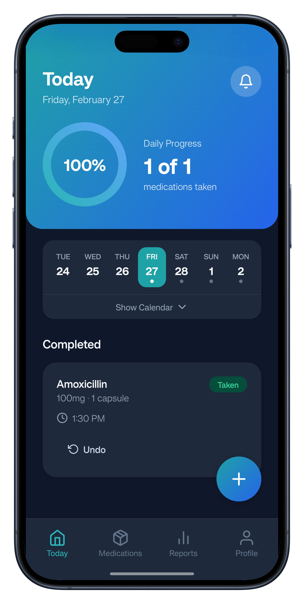
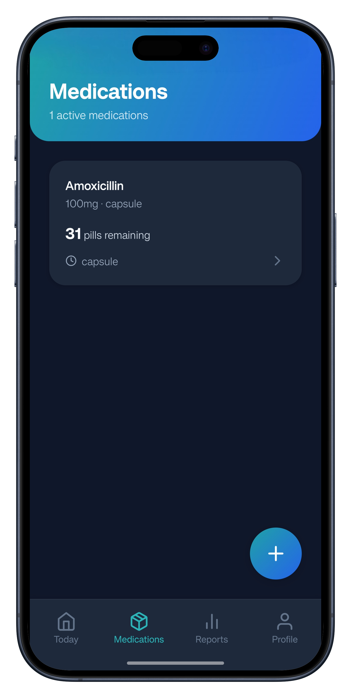
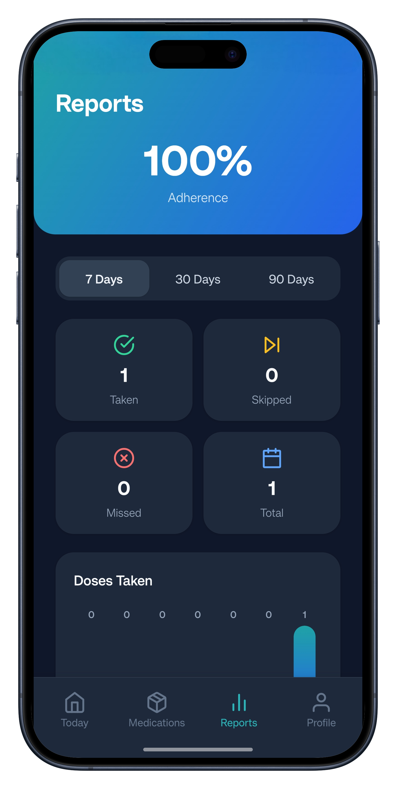
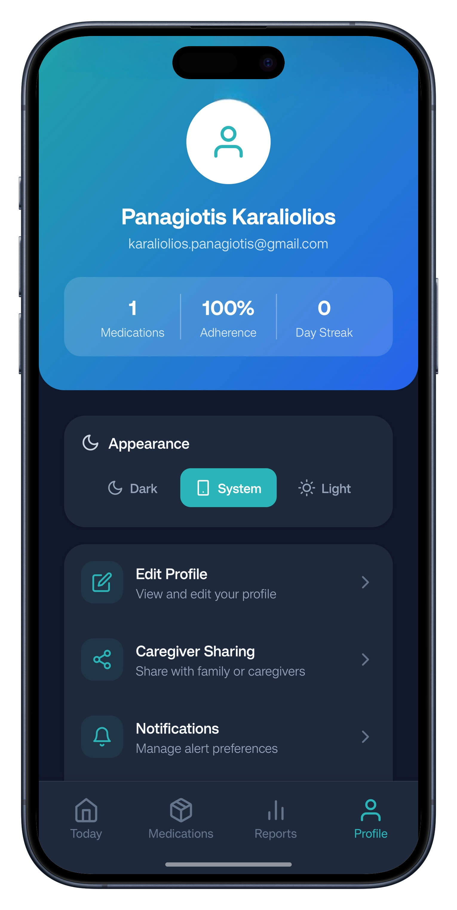

# 💊 DoseMate

DoseMate is a modern, full-featured medication management and health tracking app built with Expo and React Native. Manage medications, set smart reminders, track doses and adherence, monitor medication supplies, check drug interactions, log symptoms and side effects, and view detailed health reports. Share medication summaries with caregivers and stay on top of your daily health routine, all from one easy-to-use app.

---

## 📱 Screenshots

  <picture>
    
  </picture>
  &nbsp;&nbsp;
  <picture>
    
  </picture>
  &nbsp;&nbsp;
  <picture>
    
  </picture>
  &nbsp;&nbsp;
  <picture>
    
  </picture>

  <em>Today Dashboard &nbsp;·&nbsp; Medications &nbsp;·&nbsp; Reports &nbsp;·&nbsp; Profile</em>

---

